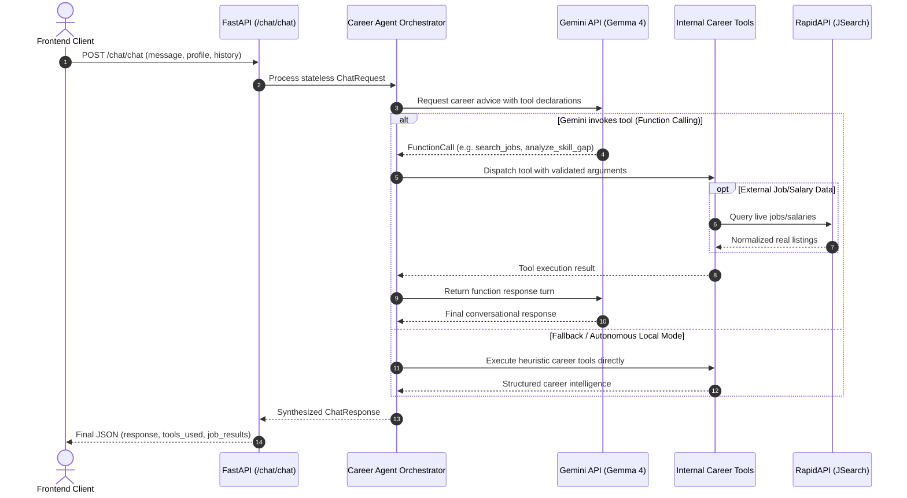

# SkillBridge AI — Professional Backend (Stateless Architecture)

[](https://opensource.org/licenses/MIT)
[](https://www.python.org/)
[](https://fastapi.tiangolo.com)
[-orange.svg)](https://ai.google.dev/gemma)
[-lightgrey.svg)](#stateless-architecture)

**SkillBridge AI** is a career mentorship backend built for the **Hacktoberfest Hack Day Faisalabad Open-Source AI and Gemma 4 challenges**. It orchestrates career transition guidance, resume structural audits, personalized learning roadmaps, portfolio project recommendations, and live job/salary insights from RapidAPI.

---

## 1. Problem and Solution

- **The Problem:** Modern engineering students and transitioning developers struggle to pinpoint real-world skill gaps between their current proficiencies and desired tech roles. Many existing tools require invasive database logins, persist sensitive user resumes indefinitely, or hallucinate fictitious jobs and salaries.
- **The Solution:** SkillBridge AI operates in **complete stateless mode**—no database, no persistent user tracking, and no server-side retention of CVs or conversation logs. It leverages Google Gemini API with the **Gemma 4 model** (`gemma-4-26b-a4b-it`) and verified **RapidAPI job/salary aggregators** to provide real-time career guidance and live job opportunities.

---

## 2. Architecture & Request Flow



---

## 3. Core Features

1. **Stateless AI Career Guidance**: Pure in-memory calculation based strictly on the current request turn.
2. **Skill-Gap Analysis**: Calculates readiness percentages and prioritizes high-impact skills to master for roles like AI Engineer, Backend Developer, Data Scientist, etc.
3. **Weekly Learning Roadmaps**: Builds 4–16 week structured plans with hands-on lab deliverables and capstone milestones.
4. **Real Job & Salary Intel**: Directly interfaces with RapidAPI (`jsearch.p.rapidapi.com`) to retrieve verified openings and compensation benchmarks without hallucinating links or salaries.
5. **Resume & ATS Quality Audits**: Structural review for action verbs, metrics, and missing sections. Clearly marks scores as automated estimates.
6. **Zero Database Footprint**: No SQLite, Postgres, Mongo, or Redis. Zero ORMs, connections, or tables.

---

## 4. Tech Stack

- **Framework**: [FastAPI](https://fastapi.tiangolo.com/) (Asynchronous REST API)
- **Runtime**: Python 3.10+ (Tested on Python 3.11 & 3.13)
- **AI Engine**: Google Gemini API via `google-genai` / REST integration
- **Target Model**: `gemma-4-26b-a4b-it` (Gemma 4)
- **Live Data**: [RapidAPI](https://rapidapi.com/) (e.g. JSearch) via `httpx`
- **Validation**: [Pydantic v2](https://docs.pydantic.dev/) & `pydantic-settings`
- **Testing**: `pytest` & `pytest-asyncio`
- **Package Management**: `uv`

---

## 5. Directory Structure

```
backend/
├── main.py                     # Application entrypoint & CORS middleware
├── config.py                   # Pydantic BaseSettings configuration
├── requirements.txt            # Python dependencies
├── pyproject.toml              # Build & test configuration
├── .env.example                # Configuration template
├── LICENSE                     # MIT License
├── README.md                   # Complete documentation
├── routes/
│   ├── __init__.py
│   ├── chat_routes.py          # POST /chat/chat endpoint
│   └── health_routes.py        # GET /health operational endpoint
├── agents/
│   ├── __init__.py
│   ├── career_agent.py         # Gemini / Gemma 4 agent loop & fallback synthesizer
│   └── instructions.py         # System prompt and ethical guidelines
├── tools/
│   ├── __init__.py             # Tool registry, declarations, & dispatcher
│   ├── career_tools.py         # 10 internal career & resume tools
│   ├── job_tools.py            # RapidAPI search & match functions
│   └── salary_tools.py         # RapidAPI salary estimation tool
├── services/
│   ├── __init__.py
│   ├── gemini_service.py       # Google Gemini API connector
│   └── rapidapi_service.py     # RapidAPI async HTTP client
├── schemas/
│   ├── __init__.py
│   └── chat_schemas.py         # Pydantic schemas (ChatRequest, ChatResponse, etc.)
└── tests/
    ├── test_health.py          # Operational & health route tests
    ├── test_chat.py            # Chat validation & stateless integration tests
    ├── test_tools.py           # Tool argument validation & dispatch tests
    └── test_services.py        # Mocked external Gemini & RapidAPI tests
```

---

## 6. Registered Internal Career Tools

The backend registers 13 specialized internal career functions:

| Tool Name | Purpose | Stateless Behavior |
| :--- | :--- | :--- |
| `career_guidance` | Recommends career paths from education & interests | In-memory taxonomy analysis |
| `analyze_cv` | Structural audit for sections, metrics, action verbs | Evaluates text in-memory |
| `match_jobs` | Scores relevance of live jobs against user skills | Computes overlap percentages |
| `analyze_skill_gap` | Identifies missing skills for target roles | Maps against tech ontology |
| `create_learning_roadmap` | Generates weekly milestones and project tasks | Generates structured schedule |
| `write_cv` | Formats truthful ATS-friendly resume bullets | Uses provided facts only |
| `prepare_interview` | Technical & behavioral STAR interview questions | Role-specific question bank |
| `generate_portfolio_project`| Tailors full-stack / AI capstone project specs | Recommends architecture specs |
| `check_ats_quality` | Evaluates resume against job description keywords | Labeled as estimate |
| `track_career_progress` | Summarizes progress on completed milestones | Stateless calculation |
| `search_jobs` | Retrieves real job postings via RapidAPI | No fabricated openings |
| `search_jobs_by_company` | Filters company-specific openings via RapidAPI | Real provider results |
| `search_salaries` | Retrieves salary benchmark estimates | Live provider data |

---

## 7. Environment Configuration

Copy `.env.example` to create your local `.env`:

```bash
cp .env.example .env
```

Set your credentials in `.env`:

```ini
GEMINI_API_KEY=your_actual_gemini_api_key
GEMINI_MODEL=gemma-4-26b-a4b-it
RAPIDAPI_KEY=your_actual_rapidapi_key
RAPIDAPI_HOST=jsearch.p.rapidapi.com
```

> **Security Note**: Never commit `.env` to git. The `.gitignore` file already excludes `.env`.

---

## 8. Installation and Execution

### Using `uv` (Recommended)

```bash
# Navigate to the backend directory
cd backend

# Sync dependencies
uv sync

# Run the test suite
uv run pytest -v

# Start the development server
uv run uvicorn main:app --reload --port 8000
```

### Using standard `pip`

```bash
cd backend
python -m venv .venv
# On Windows:
.venv\Scripts\activate
# On Linux/macOS:
# source .venv/bin/activate

pip install -r requirements.txt
pytest -v
uvicorn main:app --reload --port 8000
```

The API will be accessible at:
- **Root**: `http://localhost:8000/`
- **Swagger Docs**: `http://localhost:8000/docs`
- **Health Check**: `http://localhost:8000/health`
- **Chat Endpoint**: `http://localhost:8000/chat/chat`

---

## 9. API Examples

### Health Check (`GET /health`)

**Response:**
```json
{
  "status": "ok",
  "service": "SkillBridge AI",
  "database": "not_used",
  "stateless": true,
  "gemini_model": "gemma-4-26b-a4b-it"
}
```

### Career Guidance Chat (`POST /chat/chat`)

**Request:**
```json
{
  "message": "I know Python and FastAPI. Help me become an AI engineer.",
  "profile": {
    "education": "Software Engineering student",
    "skills": ["Python", "FastAPI"],
    "experience_level": "Beginner",
    "target_role": "AI Engineer"
  },
  "conversation_history": []
}
```

**Response:**
```json
{
  "success": true,
  "message": "### 🚀 Personalized Career Guidance for **AI Engineer**\n\nWelcome to **SkillBridge AI**!...",
  "tools_used": [
    "analyze_skill_gap",
    "create_learning_roadmap"
  ],
  "model_used": "gemma-4-26b-a4b-it",
  "job_results": null,
  "salary_results": null
}
```

---

## 10. Third-Party Dependencies and Licensing

- **Project License**: MIT License (`LICENSE`)
- **Gemma Model**: Governed by the [Gemma Terms of Use and License](https://ai.google.dev/gemma/terms).
- **Google GenAI SDK**: Apache-2.0 License.
- **FastAPI**: MIT License.
- **Pydantic**: MIT License.
- **HTTPX**: BSD-3-Clause License.
- **RapidAPI / JSearch**: Subject to RapidAPI provider terms and rate quotas.

---

## 11. Troubleshooting & Known Limitations

- **Gemma 4 Gemini Endpoint Compatibility**: In the event that a developer's specific Gemini API project has not yet enabled the experimental Gemma 4 endpoint (`gemma-4-26b-a4b-it`) or lacks function-calling quota, SkillBridge AI features an autonomous fallback engine that automatically executes the appropriate career tools and delivers structured guidance without throwing 500 errors.
- **RapidAPI Free Tier Rate Limits**: RapidAPI free tiers typically allow a limited number of requests per month. If rate limits are exceeded (HTTP 429), the tool returns a graceful advisory notice rather than crashing.
